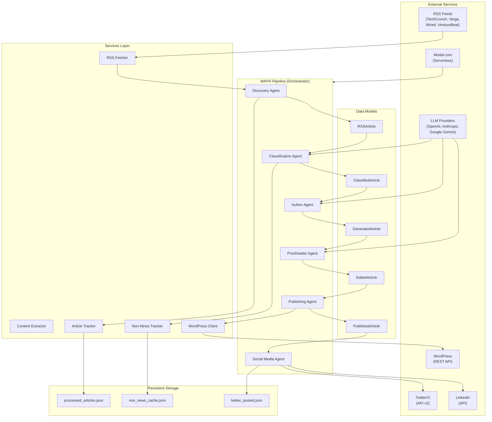
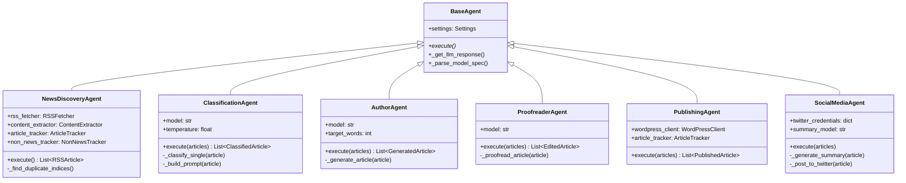
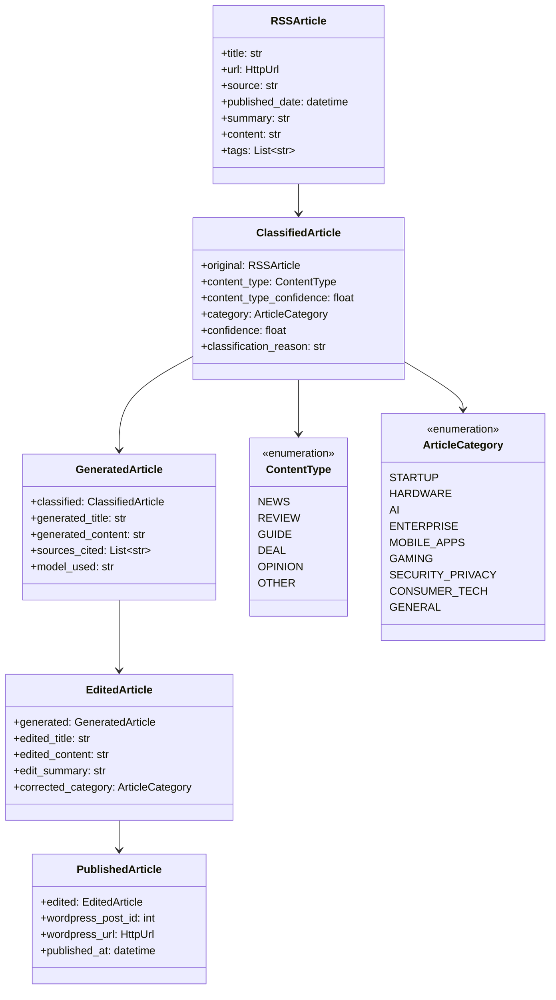
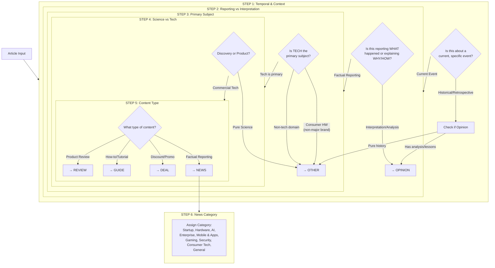
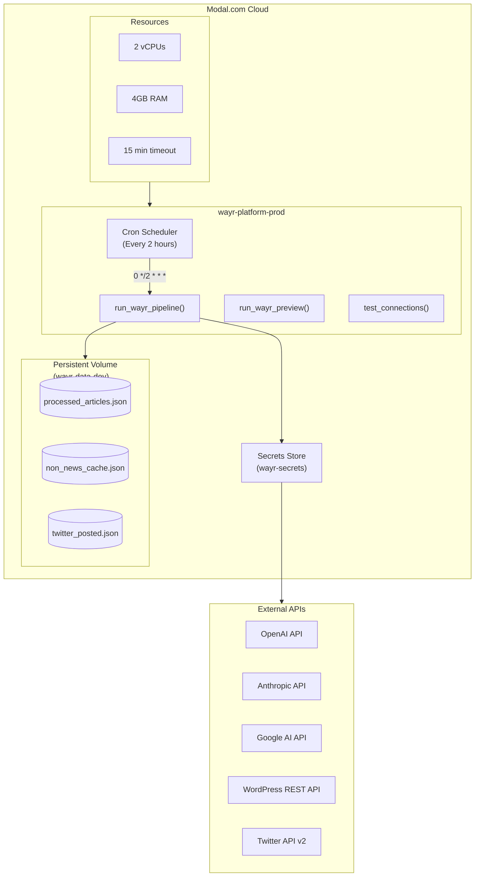
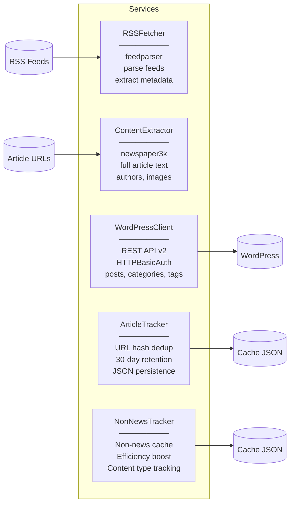
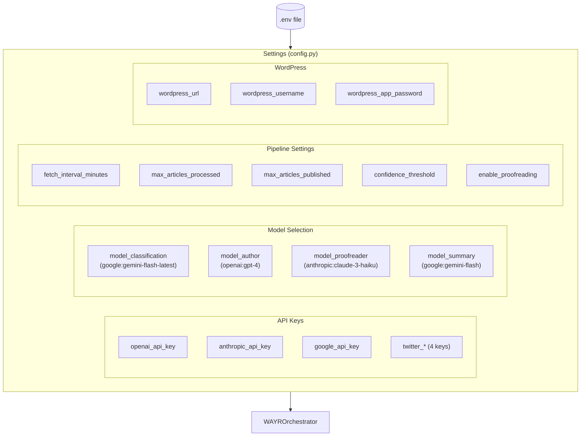

# WAYR Platform Architecture

## High-Level System Architecture

## Pipeline Data Flow

```mermaid
flowchart LR
    subgraph Step1["Step 1: Discovery"]
        RSS[("RSS Feeds")] --> Fetch["Fetch Articles"]
        Fetch --> Dedup["Deduplicate"]
        Dedup --> Filter["Filter Non-News"]
        Filter --> Extract["Extract Content"]
    end

    subgraph Step2["Step 2: Classification"]
        Extract --> Classify["Classify<br/>(L1: Content Type)"]
        Classify --> CatFilter["Filter NEWS only"]
        CatFilter --> Category["Categorize<br/>(L2: Category)"]
        Category --> ConfFilter["Confidence Filter"]
    end

    subgraph Step3["Step 3: Generation"]
        ConfFilter --> Generate["Generate Article<br/>(~300 words)"]
        Generate --> Citations["Add Citations"]
    end

    subgraph Step4["Step 4: Proofreading"]
        Citations --> Edit["Edit & Polish"]
        Edit --> CatCheck["Category Correction<br/>(if needed)"]
    end

    subgraph Step5["Step 5: Publishing"]
        CatCheck --> WP["WordPress<br/>Create Post"]
        WP --> Track["Track as<br/>Processed"]
    end

    subgraph Step6["Step 6: Social"]
        Track --> Summary["Generate<br/>Summary"]
        Summary --> Tweet["Post to<br/>Twitter"]
        Summary --> LinkedIn["Post to<br/>LinkedIn"]
    end
```

## Agent Architecture

## Data Models

## Classification Logic Flow

## Deployment Architecture

## Services Layer

## Configuration Structure

